<div align="center">


# Tu Amigo Pet

E-commerce y sistema de gestión para una tienda y veterinaria de barrio, con catálogo, farmacia, agenda online, pagos con Webpay y panel de administración.


**[🌐 Demo en vivo](https://tu-amigo-pet.vercel.app)** · [Capturas](#-capturas) · [Instalación](#-instalación-local)

<sub>Sitio de demostración: productos y datos ficticios, y Webpay en ambiente de pruebas, sin cobros reales.</sub>

</div>

---

## 📑 Tabla de contenidos

- [¿Qué es?](#-qué-es)
- [Contexto del proyecto](#-contexto-del-proyecto)
- [Capturas](#-capturas)
- [Funcionalidades](#-funcionalidades)
- [¿Cómo funciona?](#️-cómo-funciona)
- [Stack tecnológico](#️-stack-tecnológico)
- [Arquitectura](#-arquitectura)
- [Estructura del proyecto](#️-estructura-del-proyecto)
- [Base de datos](#️-base-de-datos)
- [Instalación local](#-instalación-local)
- [Despliegue](#-despliegue)
- [Seguridad](#-seguridad)
- [Aprendizajes](#-aprendizajes)
- [Mejoras futuras](#-mejoras-futuras)
- [Autor](#-autor)
- [Créditos y licencia](#-créditos-y-licencia)

---

## 📌 ¿Qué es?

Aplicación web que simula la operación completa de una tienda local de mascotas con veterinaria. El cliente puede comprar alimento y accesorios, revisar la farmacia, pagar con Webpay, seguir su pedido y agendar una hora en la clínica o un día de guardería. El negocio administra productos, inventario, pedidos y reservas desde un panel propio.

## 🎯 Contexto del proyecto

Lo desarrollé como práctica y proyecto de portafolio. Quería ir más allá de un catálogo con carrito y resolver lo que un negocio de barrio necesita en el día a día: saber qué le queda en bodega, no vender dos veces la última unidad, ordenar su agenda y recibir pagos.

También me propuse que no se viera como una plantilla. La identidad visual parte de las cortinas metálicas pintadas a mano de los locales de barrio, y por eso la portada abre con una cortina que sube para mostrar la tienda.

## 📸 Capturas

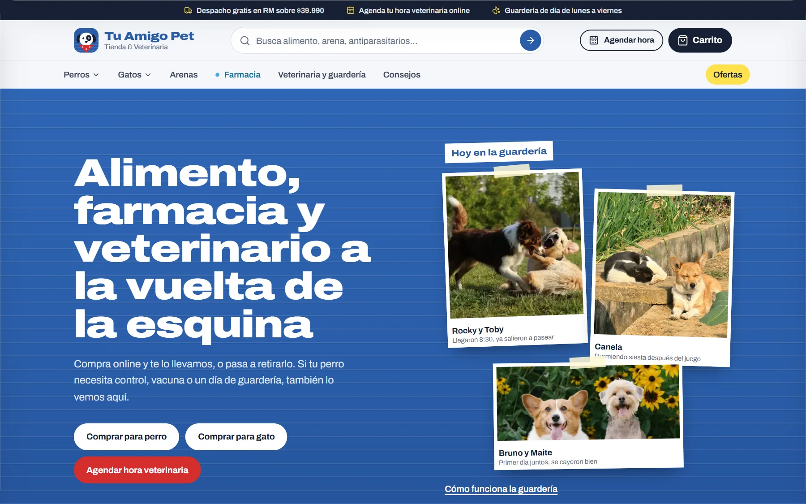

| Catálogo con filtros | Ficha de producto |
|:---:|:---:|
| 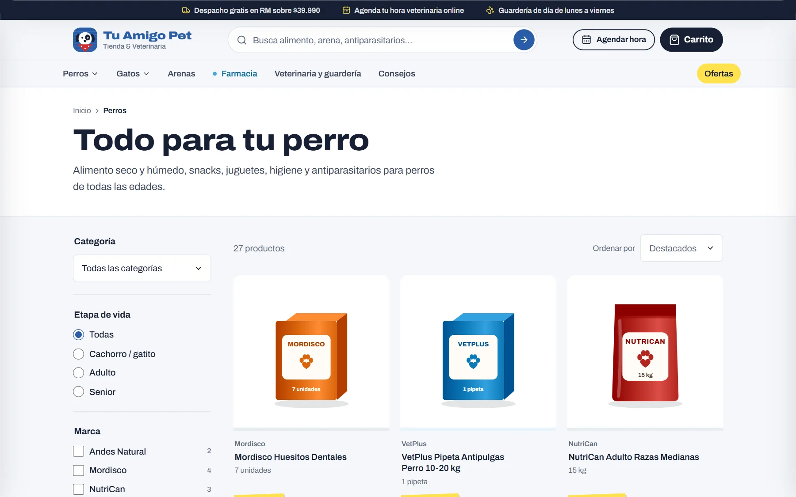 | 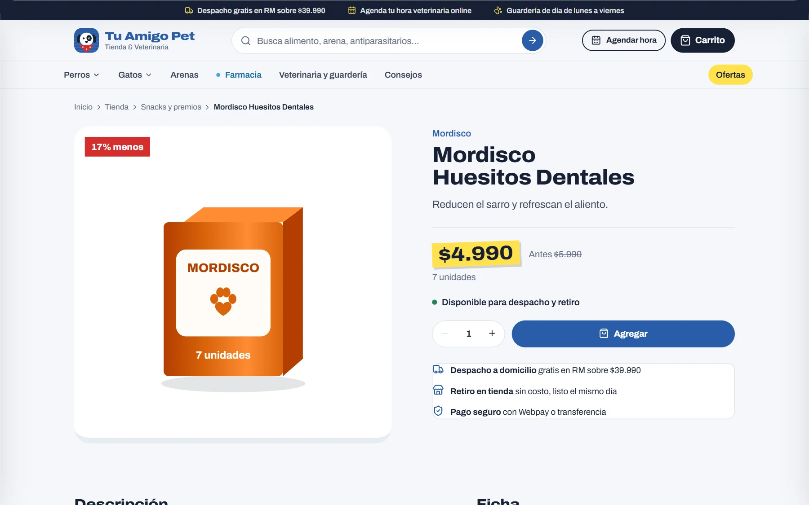 |
| **Farmacia veterinaria** | **Servicios** |
| 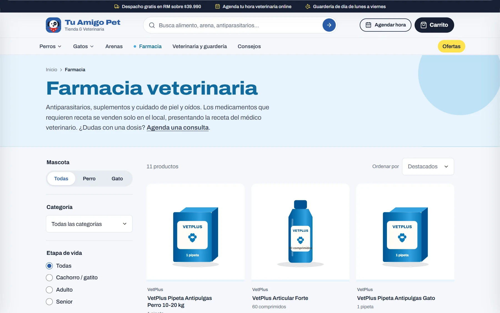 | 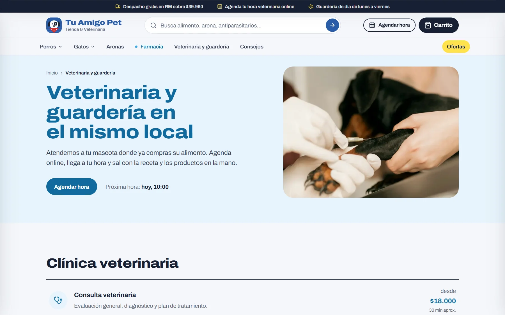 |
| **Agenda online** | **Finalizar compra** |
| 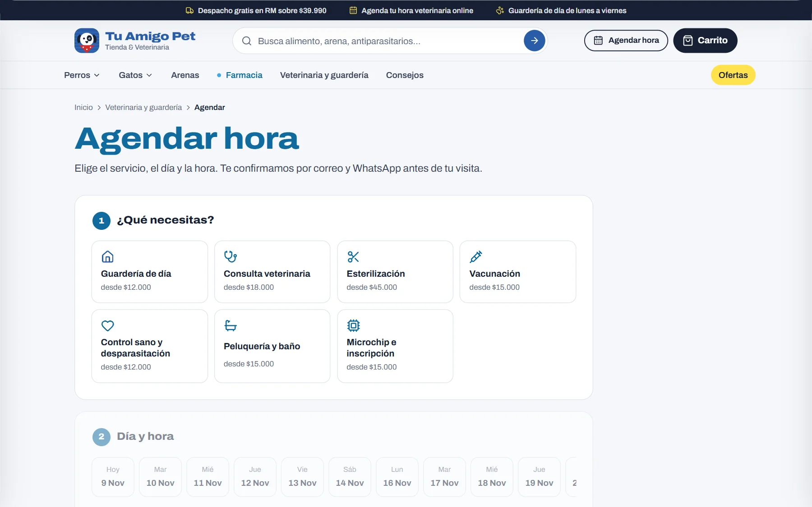 | 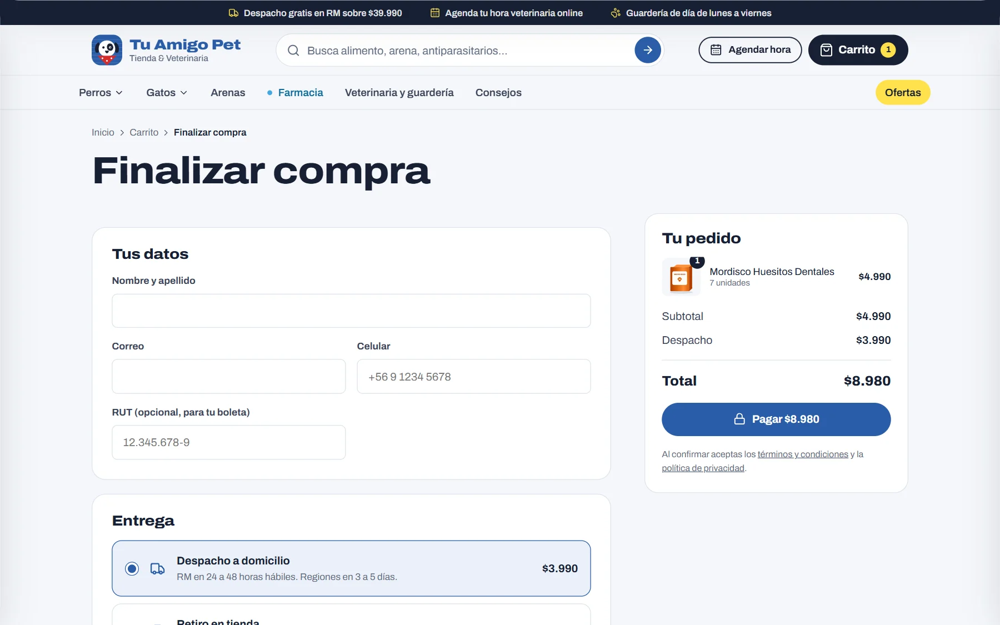 |

### Panel de administración

| Resumen del negocio | Pedidos |
|:---:|:---:|
| 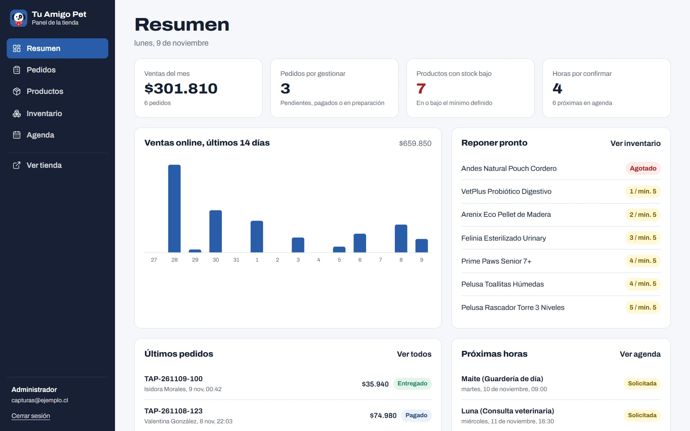 | 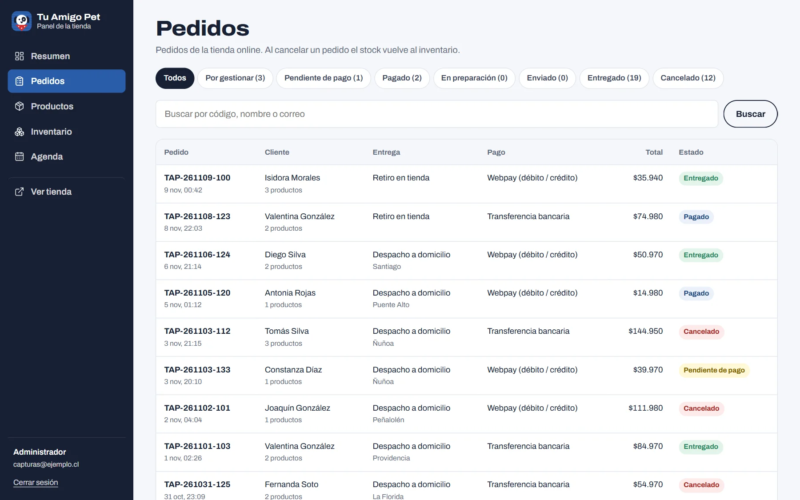 |
| **Inventario** | **Agenda** |
| 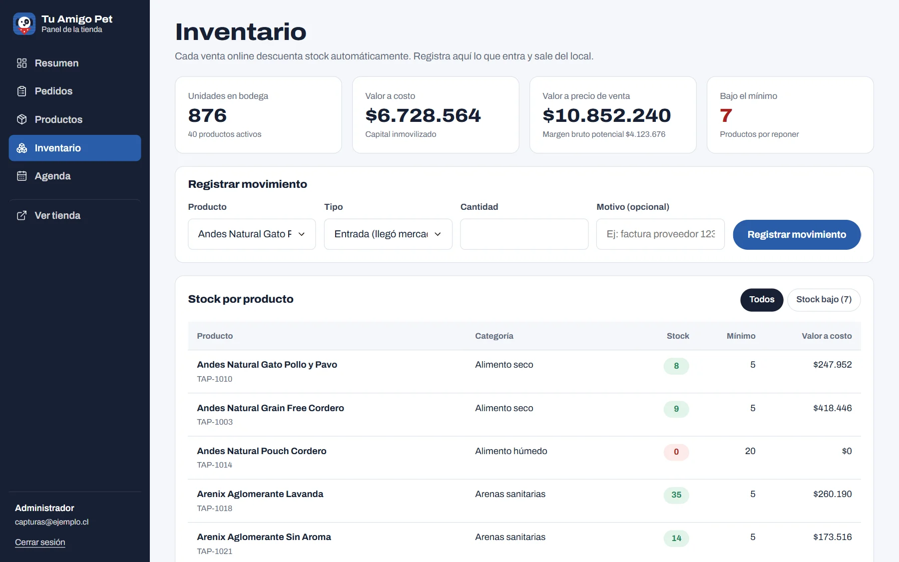 | 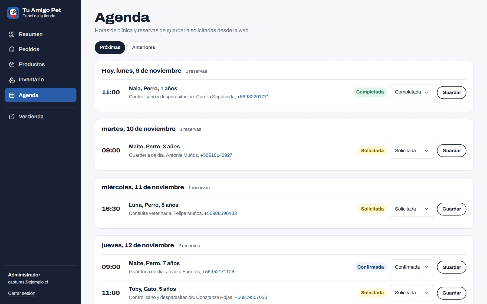 |

### Versión móvil

| Portada | Catálogo | Producto |
|:---:|:---:|:---:|
| 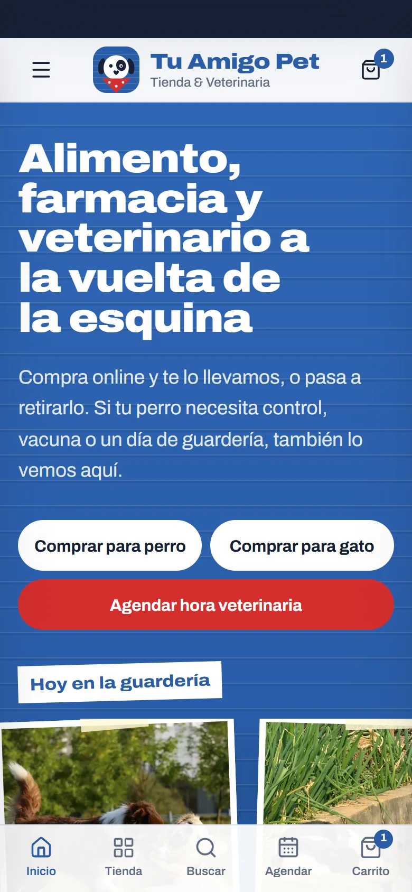 | 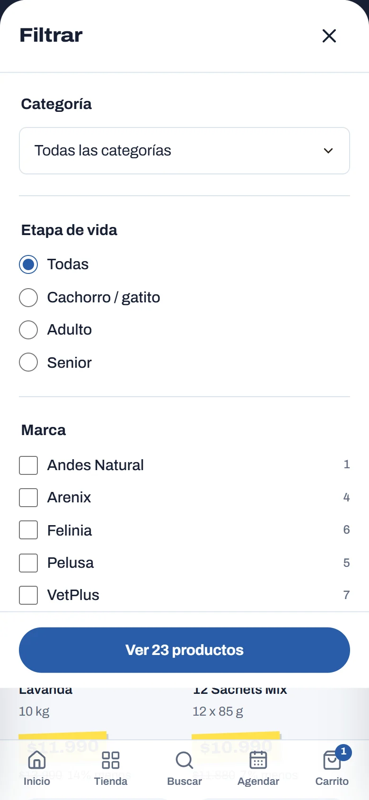 | 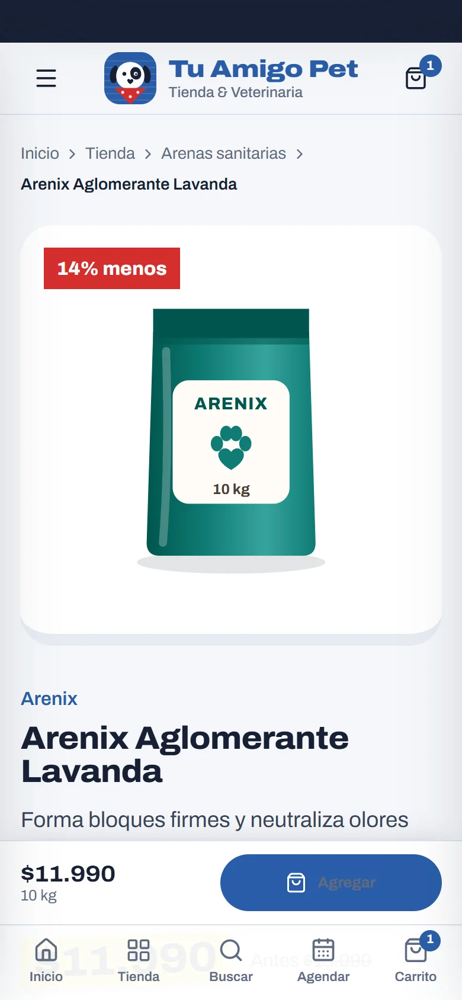 |

## ✨ Funcionalidades

### Tienda

- **Catálogo** por mascota, categoría, etapa de vida, marca y precio, con orden y paginación.
- **Buscador** con autocompletado y navegación por teclado.
- **Ficha de producto** con stock en tiempo real, aviso de últimas unidades y productos relacionados.
- **Carrito persistente** con medidor de despacho gratis.
- **Checkout** con despacho o retiro en tienda, cálculo de envío por región y validación de RUT y celular chilenos.
- **Medios de pago:** Webpay Plus, transferencia bancaria y pago al retirar con reserva de 48 horas.
- **Seguimiento de pedido** por código y correo, con línea de tiempo y comprobante de pago.

### Farmacia, clínica y guardería

- **Farmacia** con identidad visual propia en celeste. Los medicamentos con receta se exhiben, pero no se pueden comprar online.
- **Agenda con disponibilidad real:** un bloque por atención en la clínica y cupos diarios en la guardería.
- La portada calcula y muestra la **próxima hora disponible**.

### Panel de administración

- **Resumen** con ventas del mes, pedidos por gestionar, productos por reponer y ventas de los últimos 14 días.
- **Productos:** creación, edición, ofertas, destacados y subida de fotos.
- **Inventario:** entradas, salidas y ajustes por conteo físico, con historial y valorización.
- **Pedidos:** filtros y cambio de estado. Al cancelar uno, el stock vuelve al inventario automáticamente.
- **Agenda:** confirmación, cierre o cancelación de reservas.

### Contenido y SEO

- Blog de consejos de cuidado.
- Metadatos por página, URLs canónicas, `sitemap.xml` dinámico, `robots.txt` y manifiesto web.
- Datos estructurados schema.org: `PetStore`, `VeterinaryCare`, `Product`, `Service`, `BlogPosting`, `FAQPage` y `BreadcrumbList`.
- Imagen Open Graph generada para compartir en redes sociales.

## ⚙️ ¿Cómo funciona?

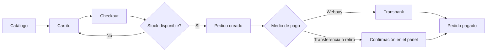

El carrito vive en el navegador, pero el servidor vuelve a leer precios y stock antes de crear el pedido. El stock se descuenta en la misma transacción que crea el pedido, y cada cambio queda registrado como un movimiento de inventario. Con Webpay, el pedido solo pasa a pagado después de confirmar la transacción con Transbank y comprobar que el monto coincide.

## 🛠️ Stack tecnológico

| Capa | Tecnología | Uso en el proyecto |
|---|---|---|
| Framework | Next.js 15 (App Router) y React 19 | Páginas, Server Components, Server Actions y endpoints |
| Lenguaje | TypeScript | Tipado de todo el proyecto |
| Base de datos | PostgreSQL y Prisma | Modelo de datos, consultas y transacciones |
| Estilos | CSS Modules y variables propias | Diseño a medida, sin frameworks de UI |
| Estado | Zustand | Carrito persistente en el navegador |
| Validación | Zod | Reglas de formularios, RUT y celular |
| Autenticación | JWT con `jose` y `bcryptjs` | Sesión del panel en cookie `httpOnly` |
| Pagos | Webpay Plus (`transbank-sdk`) | Creación, confirmación y reversa de pagos |
| Archivos | Vercel Blob | Fotos de productos subidas desde el panel |
| Hosting | Vercel y Neon | Aplicación y PostgreSQL administrado |

## 🧩 Arquitectura

El proyecto separa las responsabilidades por carpeta:

- **Páginas (`src/app`):** se generan en el servidor y consultan los datos directamente. Los grupos `(tienda)` y `(panel)` separan el sitio público del panel.
- **Acciones (`src/server`):** todo lo que escribe en la base pasa por Server Actions que validan los datos antes de guardar.
- **Lógica compartida (`src/lib`):** catálogo, agenda, validaciones, sesión, Webpay y utilidades.
- **Componentes (`src/components`):** agrupados por dominio, con su CSS Module al lado.
- **Configuración (`src/config/site.ts`):** datos del negocio, envíos y medios de pago en un solo lugar. Al cambiarlos se actualizan los textos, el SEO y el checkout.

Algunas decisiones que tomé:

- **Sin sobreventa.** El descuento de stock usa una actualización condicional (`stock >= cantidad`). Si dos personas compran la última unidad al mismo tiempo, solo una lo logra.
- **El servidor es la fuente de verdad.** Precios, despacho y disponibilidad nunca se toman de lo que envía el navegador.
- **Inventario auditable.** El stock solo cambia mediante movimientos, así que cada diferencia se puede rastrear.
- **Precios congelados.** Cada ítem guarda el nombre y el precio del momento de la compra.
- **Diseño móvil propio.** Barra de navegación inferior, filtros en panel deslizable y carruseles táctiles.

## 🗂️ Estructura del proyecto

```text
tu-amigo-pet/
├── prisma/
│   ├── schema.prisma
│   └── seed.ts
├── docs/capturas/
└── src/
    ├── app/
    │   ├── (tienda)/
    │   ├── admin/
    │   └── api/
    ├── components/
    ├── config/
    ├── content/
    ├── lib/
    ├── server/
    └── middleware.ts
```

| Carpeta | Contenido |
|---|---|
| `prisma/` | Modelo de datos y carga de datos de ejemplo |
| `src/app/(tienda)/` | Sitio público: catálogo, farmacia, servicios, blog, compra y pedidos |
| `src/app/admin/` | Inicio de sesión y panel de administración |
| `src/app/api/` | Búsqueda, horarios disponibles, subida de fotos y retorno de Webpay |
| `src/components/` | Componentes agrupados por dominio |
| `src/config/` | Datos del negocio, envíos y medios de pago |
| `src/content/` | Artículos del blog y fotografías de referencia |
| `src/lib/` | Lógica compartida y utilidades |
| `src/server/` | Server Actions de pedidos, reservas y administración |
| `src/middleware.ts` | Protección de las rutas del panel |

## 🗄️ Base de datos

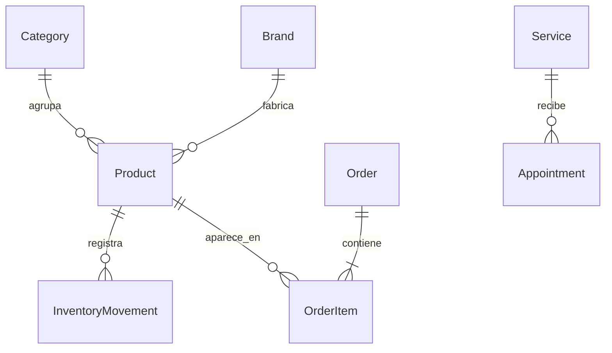

| Tabla | Contenido |
|---|---|
| `Product`, `Category`, `Brand` | Catálogo. Las categorías se separan en tienda y farmacia |
| `InventoryMovement` | Entradas, salidas, ajustes, ventas y devoluciones, con el stock resultante |
| `Order`, `OrderItem` | Pedidos, precios congelados y datos del comprobante de pago |
| `Service`, `Appointment` | Servicios de clínica y guardería, y sus reservas |
| `AdminUser`, `Subscriber` | Usuarios del panel y suscriptores del boletín |

## 💻 Instalación local

Requisitos: Node.js 20 o superior y Git.

```bash
git clone https://github.com/Z4LT1/tu-amigo-pet.git
cd tu-amigo-pet
npm install
cp .env.example .env
```

En `.env`, define `AUTH_SECRET` y `ADMIN_PASSWORD`. Luego, en una terminal aparte, levanta PostgreSQL local:

```bash
npx prisma dev
```

Copia la URL que muestra en `DATABASE_URL`, crea las tablas con los datos de ejemplo y ejecuta el sitio:

```bash
npm run db:push
npm run db:seed
npm run dev
```

La tienda queda en `http://localhost:3000` y el panel en `http://localhost:3000/admin`.

Webpay funciona de inmediato con el ambiente de pruebas de Transbank, sin credenciales. La tarjeta de prueba aparece en la pantalla de pago.

## 🚀 Despliegue

El sitio está publicado en **Vercel**, en la región de São Paulo, con la base de datos en **Neon** y las fotos en **Vercel Blob**. Cada cambio en la rama principal se publica automáticamente. Las variables de entorno necesarias están descritas en `.env.example`.

## 🔒 Seguridad

- **Contraseñas cifradas** con bcrypt, y mismo mensaje de error exista o no el correo.
- **Sesión firmada** (JWT) en cookie `httpOnly` y `sameSite`, con expiración de 8 horas.
- **Doble control de acceso:** el middleware protege las rutas del panel y cada acción vuelve a comprobar la sesión.
- **Validación en el servidor** con Zod en todos los formularios, y consultas parametrizadas mediante Prisma.
- **Límite de intentos** en inicio de sesión, compras y reservas.
- **Pagos verificados con Transbank:** el pedido no cambia por lo que indique el navegador, y se evita confirmar dos veces la misma transacción.
- **Subida de archivos restringida** a JPG, PNG y WebP de hasta 4 MB, con nombres aleatorios y sesión obligatoria.
- **Credenciales fuera del repositorio** mediante variables de entorno.
- **Cabeceras de seguridad** como `X-Content-Type-Options`, `X-Frame-Options` y `Referrer-Policy`.

## 📚 Aprendizajes

- Modelar un **flujo de compra completo**, desde el carrito hasta la confirmación del pago.
- Evitar **condiciones de carrera** en el stock con transacciones y actualizaciones condicionales.
- Integrar una **pasarela de pago real** y manejar pagos aprobados, anulados, expirados y recargas de página.
- Trabajar con **Server Components y Server Actions** en el App Router de Next.js.
- Construir un **sistema de diseño propio** con identidad visual, sin depender de librerías de UI.
- Aplicar **SEO técnico** y datos estructurados para un negocio local.
- Desplegar con **Vercel, Neon y almacenamiento de objetos**, resolviendo conexiones y variables entre servicios.

## 🔭 Mejoras futuras

- [ ] **Correos automáticos** de confirmación de pedido y reserva.
- [ ] **Liberación automática** del stock de pedidos sin pagar.
- [ ] **Boleta electrónica** mediante un proveedor certificado.
- [ ] **Cuentas de cliente** con historial y recompra rápida.
- [ ] Edición de **blog, servicios y categorías** desde el panel.
- [ ] **Roles** de usuario en el panel.
- [ ] **Pruebas automatizadas** de los flujos de compra y agenda.

## 👤 Autor

**Roberto Sebastián Sepúlveda Quintana**: Analista Programador

[](https://github.com/Z4LT1)
[](https://www.linkedin.com/in/robertosepulvedaq)

## 📄 Créditos y licencia

Fotografías de referencia de [Unsplash](https://unsplash.com), bajo la licencia de Unsplash. Las marcas, productos, pedidos y datos de contacto de la demo son ficticios. Este repositorio se publica con fines de portafolio y no tiene licencia de uso comercial.
